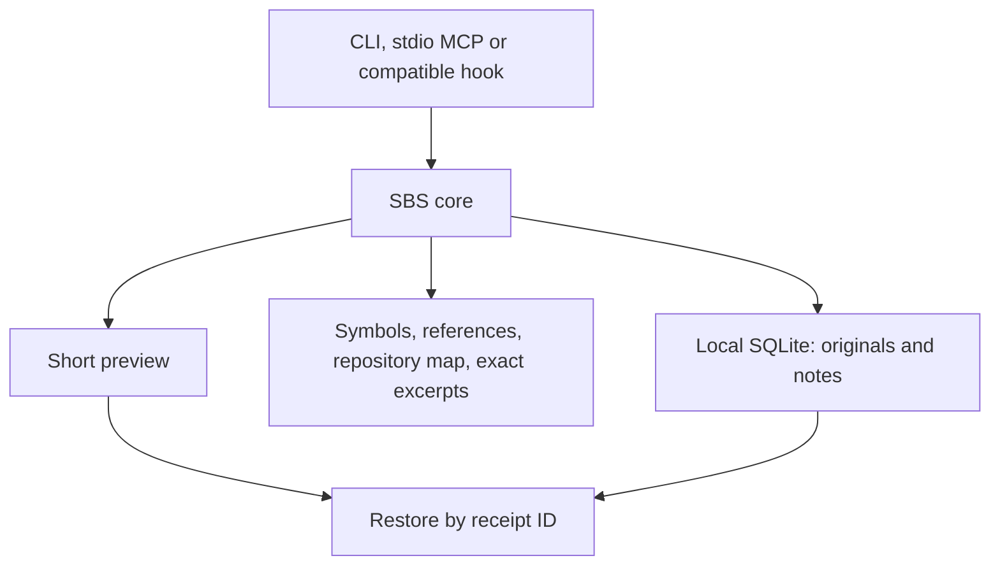

<div align="center">

# STOP-BULLSHITING

**Smaller terminal output. Inspectable previews. Recoverable originals.**

*A Python CLI for focused retrieval and smaller tool output. No mandatory runtime dependencies.*

[](https://github.com/searadacunha/Stop-Bullshiting/actions/workflows/ci.yml)


[Install](#install) · [Command guide](#command-guide) · [Integrations](#connect-to-claude-code-and-codex) · [Troubleshooting](#troubleshooting) · [Limits](#safety-privacy-and-limitations)

</div>

## Why it exists

Coding agents read huge logs, repetitive terminal output, massive JSON objects, code they never needed, and the same project notes again and again. That can waste context window space. **Stop-Bullshiting** replaces long outputs with bounded, inspectable previews, keeps originals available on disk, and makes focused retrieval easy.

```bash
sbs run -- git log --oneline -1000
sbs bench
```

Run the first command inside a Git repository. When output is reduced, copy the restoration command printed by SBS to read the full original again. `sbs bench` uses a built-in synthetic sample and needs no file.

**It does not increase Claude/Codex quotas, create extra tokens or guarantee lower bills.** It measures character reduction and optionally counts text with a named reference tokenizer; actual usage depends on the agent, model, caching and subsequent requests. Use the CLI directly to inspect its behavior before enabling automatic integrations.

## Features

| Feature | What it does |
|:--|:--|
| **Selective output reduction** | Shortens eligible JSON, logs and text; protects recognized diagnostics and leaves detected code, diffs and CSV unchanged in auto mode |
| **Command-aware views** | Understands `git status/log/diff/show`, pytest, unittest, jest, vitest, go and cargo tests, `rg` and `grep`: removes passing rows, hints, repeated paths and lockfile hunks, and keeps every commit, match and diagnostic |
| **Targeted recovery** | Saves full originals locally; retrieve complete matching lines before surrounding context, with a total response budget and explicit search coverage |
| **Agent hook adapters** | Opt-in Claude `PostToolUse` (Bash, Grep) and Codex `PreToolUse` adapters, tested against the real clients; see [what was verified](docs/INTEGRATIONS.md#verified-against-installed-clients) |
| **Local MCP server** | Exposes receipt search, symbols, references, a repository map, exact lines, reversible compression and notes over stdio |
| **Code navigation** | Definitions, name-based references, exact symbol source and a ranked repository outline for Python, JavaScript and TypeScript, without dependencies |
| **Persistent notes** | Per-project local SQLite notes, never sent to an external indexing service |
| **Real usage counters** | Reads every local Claude/Codex session log, counting each response once, without inventing tokens |
| **Coverage statistics** | `sbs stats` shows what the hook saw, changed and cost, how often originals were read back, and disk use |
| **Benchmark mode** | Reports character counts, optional reference-token counts, fidelity fixtures, runtime cost and [paired task trials](docs/TOKEN_EFFICIENCY.md) |
| **Terminal identity** | ANSI banner when launching Claude Code or Codex |

## Install

**Python 3.10+** is required. The core runtime has no third-party Python dependencies. Reference-token counting is an optional extra, included by the macOS installer below. Installation does **not** activate new agent hooks; integrations are opt-in.

### macOS (recommended: installer without pipx)

Run this from **any directory**. It downloads the [installer](scripts/install_macos.sh) to a temporary file and runs it only if the download succeeds:

```bash
(
  set -e
  sbs_installer="$(mktemp "${TMPDIR:-/tmp}/sbs-install.XXXXXX")"
  trap 'rm -f "$sbs_installer"' EXIT
  curl -fsSL https://raw.githubusercontent.com/searadacunha/Stop-Bullshiting/main/scripts/install_macos.sh -o "$sbs_installer"
  bash "$sbs_installer"
)
```

The installer installs or repairs **version 0.3.1**, pinned to commit `67c65ee`, with the optional token counter in `~/.local/share/stop-bullshiting/venv`. No clone, Homebrew, `pipx` or `sudo` is needed. It adds the executable directory to your zsh `PATH`, backs up an existing shell configuration before changing it, and refreshes only SBS integrations you already enabled. It finishes by printing the version and running a benchmark with the built-in sample. Its first tokenizer use may download a public vocabulary table; benchmark text is not uploaded.

Then open a **new terminal** before using `sbs`, Claude Code or Codex. If an existing Codex hook was refreshed, review it with `/hooks` inside Codex. Check the installation with:

```bash
sbs --version
sbs bench --tokenizer o200k_base
```

To update an older installation to 0.3.1 or repair this installation, rerun the same installer commands and open a new terminal. If you enabled the Claude or Codex hook, it is refreshed; review Codex hooks again with `/hooks`. This installer is pinned to 0.3.1; it does not promise a future latest version. `sbs` and `stop-bullshiting` are equivalent commands.

### macOS (alternative: pipx)

If you prefer `pipx` and have Homebrew, you can install directly from this GitHub repository. The `export` line makes the CLI available in the current terminal as well:

```bash
brew install pipx
pipx ensurepath
pipx install 'git+https://github.com/searadacunha/Stop-Bullshiting.git'
export PATH="$HOME/.local/bin:$PATH"
sbs doctor
sbs bench
```

If your terminal still reports `command not found: sbs`, open a new terminal and run `pipx list` to check whether the package was installed.

To update a pipx installation later:

```bash
pipx upgrade stop-bullshiting
```

### macOS / Linux (clone and virtual environment)

```bash
git clone https://github.com/searadacunha/Stop-Bullshiting.git
cd Stop-Bullshiting
python3 -m venv .venv
.venv/bin/python -m pip install -e .

.venv/bin/sbs doctor
.venv/bin/sbs bench
```

Run the editable installation command only from the cloned `Stop-Bullshiting` directory containing `pyproject.toml`. This method keeps the executable inside `.venv/bin/`. To run `sbs` without its path, activate the virtual environment with `source .venv/bin/activate` first.

To connect Claude Code or Codex, continue below only after the CLI is installed and `sbs doctor` succeeds.

## Command guide

| Need | Command | Result |
|:--|:--|:--|
| Reduce a command's output | `sbs run -- git log --oneline -1000` | Preview and local restoration ID when reduction is useful |
| Recover an original | Copy the `sbs show …` command printed in the preview | Complete stored text |
| Recover selected lines | Append `--start 120 --end 145` to that restoration command | Exact numbered lines from the original |
| Find inside an original | Append `--find "E_BALANCE" --context 3` to that restoration command | Literal matches and neighboring lines |
| Search recent outputs | `sbs find "E_BALANCE ledger"` | Best-matching exact passages across stored originals |
| Bound a search response | `sbs find "E_BALANCE" --max-chars 1200` | Complete matching lines within a total text budget, including headings and notices |
| List symbols | `sbs map src --name compress` | Python, JavaScript and TypeScript names and line ranges |
| Outline a repository | `sbs map . --ranked --budget 4000` | Most depended-on files and symbols within a character budget |
| Find a definition | `sbs def save_receipt src` | Where a symbol is declared |
| Find its uses | `sbs refs save_receipt src` | Lines naming the identifier, outside strings and comments |
| Read one symbol | `sbs symbol save_receipt src` | Its exact numbered source, without the rest of the file |
| Find a literal string | `sbs search "save_receipt" src` | Case-sensitive matching lines |
| Read exact lines | `sbs read src/stop_bullshiting/compress.py 1 30` | Numbered source excerpt |
| Check what the hook did | `sbs stats` | Calls seen and reduced, hook time, restores, disk use |
| Compare reduction | `sbs bench` | Character counts for the built-in sample, without storing a receipt |
| Inspect recorded usage | `sbs usage all --json` | Available provider token counters, not attributed savings |

## Connect to Claude Code and Codex

Optional hook configuration is local, reversible and backed up:

```bash
sbs setup claude
sbs setup codex
```

Optional zsh launch functions make `claude` and `codex` show the logo:

```bash
sbs setup shell
```

Alternatively, enable all three at once:

```bash
sbs setup all
```

Open a **new terminal** after `sbs setup shell`. The launcher remembers the Python interpreter that installed it, so a virtual-environment installation does not require `sbs` on the new shell's `PATH`. Keep that environment in place; rerun setup if you move or reinstall it. Your original agent binaries still run.

**Compatibility:** hook schemas are version-dependent. The hooks were run against Claude Code 2.1.316 and Codex 0.166.0 ([details](docs/INTEGRATIONS.md#verified-against-installed-clients)); other releases can differ. `sbs doctor` reports which hooks are wired, and `sbs stats` reports what they actually changed. Use `sbs run` explicitly if your client does not support the adapter. Installing the shell logo alone does not reduce agent output.

After `sbs setup codex`, open **`/hooks` inside Codex** to review and trust the new or changed hook; configuration alone does not activate it. See the [integration reference and upstream documentation](docs/INTEGRATIONS.md#documented-contracts).

To uninstall all integrations without uninstalling the package:

```bash
sbs setup all --remove
```

Existing hook configurations are merged, including preservation of third-party entries within a shared hook group; preexisting changed files are backed up. The shell launcher updates `.zshrc` when explicitly enabled; the macOS installer also uses it for the `PATH` entry. Authentication settings are not changed.

**Important:** Claude Code can rewrite a tool result after execution, and this grants no permission. Codex currently takes a different route: only narrowly allowlisted *read-only* commands are wrapped before execution, and never when one of your exec-policy rules could apply to them. Inside the default Codex sandboxes the wrapper cannot write its receipts, so output stays unreduced. These are not interchangeable features. Both integrations deliberately fail open when an output cannot be handled safely.

## Real workflows

### Reduce terminal or pipeline output

Run these examples from a project checkout. Original exit status is preserved; stderr and failing-command output are not compacted.

```bash
sbs run -- git log --oneline -1000
sbs run -- rg "TODO" .
sbs run -- python3 -m unittest discover -s tests
```

Or explicitly pipe text (`run.log` must be an existing log file):

```bash
git log --oneline -1000 | sbs compress --mode plain --stats
cat run.log | sbs compress --mode logs --max-chars 2400
```

If a result is reduced, it includes a restoration command with a real receipt ID. This is an illustrative output format; `RECEIPT_ID` is not an ID to paste:

```text
... [193 lines omitted] ...
[SBS logs: 18602 → 2110 chars; full original: sbs show RECEIPT_ID]
```

Recover everything without loss by copying the complete `sbs show …` command from **your own SBS output**. To recover only what the next step needs, append `--find "request-0055" --context 3` to that command, or append `--start 120 --end 145` for a line range. Use a search string or line range that applies to your output.

Ranges are 1-based and inclusive. `--find` is case-sensitive and literal, and can be restricted with `--start` / `--end`. Selected views consider at most 50 source lines by default (`--limit` changes this) and fit within 20,000 characters including metadata. Matching lines take priority over context within the line limit. Omitted lines are reported explicitly; oversized lines are never silently shortened. Use `--context 0` for a tighter search response. `sbs show` followed by the real receipt ID, without selectors, still returns the complete original without a cap.

You can disable local storage using `sbs compress --no-store` or `sbs run --no-store -- command`.

### Protect evidence before reducing it

In `auto` mode, output detected as source code, a diff or CSV passes through unchanged. A `git diff` only loses the hunks of generated files such as lockfiles. Use `sbs map`, `sbs symbol`, `sbs search` and `sbs read` to retrieve less source code in the first place. The explicit `--mode code`, `--mode diff` and `--mode csv` options remain available for deliberately lossy previews.

Python traceback blocks pass through unchanged in auto, logs and plain modes. Recognized diagnostic lines in logs/text are kept whole or the original is returned. In JSON, recognized failing records, their parent branches and exact diagnostic values survive sampling, including records in the middle of arrays. If the protected view cannot fit the budget, SBS returns the original. These checks recognize common markers; they cannot identify every business-critical fact.

Command-aware views only run on successful commands whose stdout is that program's own format, optionally through `head` or `tail`. They keep every commit, every search match and every test that did not simply pass, up to 30,000 characters. In paired trials agents almost never fetched omitted lines back, so a view removes redundant text rather than items. The hook does not make head-and-tail previews unless you set `SBS_COMPRESS_ALL=1`; `sbs run` and `sbs compress` still do, because you asked for them.

### Search code without dumping whole files

From the root of a Stop-Bullshiting clone:

```bash
sbs map . --ranked --budget 4000
sbs def save_receipt src
sbs refs save_receipt src
sbs symbol save_receipt src
sbs search "save_receipt" src
sbs read src/stop_bullshiting/compress.py 1 30
```

Python symbols use the syntax tree; JavaScript and TypeScript use a small built-in tokenizer. Both report start and end lines. `sbs refs` matches the identifier outside strings and comments without resolving scope, so shadowed and repeated names appear too: treat its results as candidates. `sbs map --ranked` orders files by how much other files use their names, which orients a search but is not a call graph. `sbs symbol` returns exact lines, trailing whitespace and CRLF included.

Search uses `rg` if available, with a Python fallback; both use case-sensitive literal matching. The fallback scans supported source/document extensions and skips large files and common build directories. Their file coverage can therefore differ.

### Search across recent outputs

```bash
sbs find "E_BALANCE ledger"
sbs find "E_BALANCE" --max-chars 1200
sbs find "request-0055" --limit 3 --receipts 50 --json
```

Results contain complete source lines with their original line numbers, best first. Matching lines take priority over surrounding context. `--max-chars` bounds the entire text response, including headings and omission notices (default 6,000; minimum 256). If a ranked passage cannot include any complete matching line within the remaining budget, it is reported as omitted, with its receipt and line range available for recovery. Returned passages are selected excerpts, not an exhaustive list of matching lines.

Search considers the most recent 200 receipts by default. Oversized originals are skipped without preventing smaller, older originals from being searched; coverage and omissions are reported. The index admits at most 64 MiB of uncompressed UTF-8 text per query. This is an input budget, not a bound on total Python or SQLite memory. `--json` includes structured coverage and omission metadata; the JSON envelope itself is not covered by `--max-chars`.

The index exists in memory for one query: no searchable copy of your tool output reaches the disk. SQLite FTS5 is used when available, with a Python BM25 fallback; their tokenization and ranking can differ. See the [retrieval design and reproducible checks](docs/RETRIEVAL_QUALITY.md).

### Keep compact project notes

```bash
sbs note put "test-command" "python3 -m unittest discover -s tests"
sbs note search "test"
sbs note get "test-command"
sbs note delete "test-command"
```

Notes are scoped to the current working directory unless `--scope` is specified. Avoid storing secrets.

### Analyze consumption

```bash
sbs stats
sbs usage claude
sbs usage codex
sbs usage all --json
sbs bench
```

**Different metrics, different meaning:** `sbs stats` and `sbs bench` measure characters, *not* actual model token cost. `sbs stats` also shows hook coverage per tool, mean hook time, how often originals were read back and disk use; these counters hold sizes only, never content. `sbs usage` reads token usage records, with `--since YYYY-MM-DD` for a time window, but cannot assign causality to this tool. A reliable savings claim needs an A/B test with equivalent tasks, model, caching and context: see [what was measured](docs/TOKEN_EFFICIENCY.md).

### Optional reference-token measurement

The macOS installer already includes the token counter. Use the built-in sample from any directory:

```bash
sbs bench --tokenizer o200k_base
```

For a clone installation, run this **from the cloned directory containing `pyproject.toml`**, using the virtual environment created in the installation steps:

```bash
.venv/bin/python -m pip install -e '.[tokens]'
.venv/bin/sbs bench --tokenizer o200k_base
```

For a pipx installation, install the optional counter into its environment:

```bash
pipx inject stop-bullshiting 'tiktoken>=0.7,<1'
```

`o200k_base` and `cl100k_base` are named reference encodings, not a claim about the tokenizer of your current Claude or Codex model. The first explicit use may download a public vocabulary table; input text is not uploaded. Core compression, recovery and ordinary benchmarks remain offline and dependency-free.

`reference_token_counts` counts the actual preview, including its no-storage marker. `model_tokens_measured` remains `false`: the benchmark excludes wrapper diagnostics, tool envelopes, later recovery calls and provider billing. The built-in sample is highly repetitive and does not represent a whole coding session.

The multi-fixture benchmark also checks sentinel preservation, exact restoration, unchanged short output and local compression latency. Run it from the root of a clone:

```bash
python3 scripts/benchmark_compression.py
python3 scripts/benchmark_compression.py --tokenizer o200k_base
```

For a comparison, append `--baseline` followed by the actual path to an older source checkout. To inspect deliberately lossy modes separately:

```bash
python3 scripts/benchmark_compression.py --explicit-modes
```

This script never downloads a tokenizer: an unavailable dependency or uncached vocabulary produces `null` token counts with a reason. See [the comparison, measured results and next steps](docs/TOKEN_EFFICIENCY.md).

### MCP: 12 local tools

```bash
sbs mcp
```

MCP uses stdio JSON-RPC; no server port and no cloud embeddings. Register the command as an MCP server in a supported agent. For example, if the installed client supports the following `mcp add` interface:

```bash
claude mcp add stop-bullshiting -- sbs mcp
codex mcp add stop-bullshiting -- sbs mcp
```

If a client does not support that command format, use its MCP configuration UI and set command=`sbs`, args=`["mcp"]`. Registration differs by version and is not performed automatically by `setup`.

MCP tools: `sbs_compact`, `sbs_restore`, `sbs_find`, `sbs_symbols`, `sbs_definition`, `sbs_references`, `sbs_symbol_source`, `sbs_repo_map`, `sbs_search`, `sbs_read`, `sbs_note_save`, `sbs_note_find`.

`sbs_restore` accepts optional `start`, `end`, `query`, `context` and `limit` arguments. Agents can retrieve a diagnostic beyond the first 20,000 characters without resending the entire stored output.

`sbs_find` accepts `query`, optional `limit` and optional `max_chars` (256–20,000). The character budget covers the returned text, including headings and notices. Both search and literal restoration allocate space to matching lines before context.

## Architecture



See [docs/ARCHITECTURE.md](docs/ARCHITECTURE.md), [docs/INTEGRATIONS.md](docs/INTEGRATIONS.md) and [docs/SECURITY.md](docs/SECURITY.md).

## Troubleshooting

| Symptom | Check or action |
|:--|:--|
| `sbs: command not found` | After the macOS installer, open a new terminal; its executable is `~/.local/share/stop-bullshiting/venv/bin/sbs`. For pipx, check `pipx list` and run `pipx ensurepath`; for a clone, use `.venv/bin/sbs`. |
| `pipx: command not found` | Use the macOS installer above; it does not need pipx. Install pipx with Homebrew only if you choose the alternative method. |
| `unrecognized arguments: --tokenizer` | Check `sbs --version` and `command -v sbs`: an older installation may be selected. Rerun the macOS installer to install or repair 0.3.1, then open a new terminal. |
| `zsh: command not found: #` | Interactive zsh may treat pasted comments as commands. Copy only the command blocks; the explanations are outside them. |
| A shell parse error or an unknown receipt ID | Do not paste angle-bracket placeholders or illustrative IDs. Copy the complete restoration command printed by your own SBS output. |
| Editable installation reports that `.` is not installable | Run it from the root of the cloned repository containing `pyproject.toml`. The macOS installer works from any directory and needs no clone. |
| The logo appears but output stays large | The shell launcher only displays the banner. Run `sbs doctor` to see the hooks, then `sbs stats` to see what they changed. Chained commands and agent-chosen windows such as `cat a; cat b` are left alone on purpose. |
| Small output stays unchanged | Expected: reduction occurs only when thresholds and the minimum useful gain are met. |
| A command reports `Reduction unavailable` | Its original stdout, stderr and exit status are preserved. Check available storage and `sbs doctor`; `--no-store` bypasses receipt storage. |
| A moved environment breaks a launch function | Reinstall the package and rerun `sbs setup shell`, or remove its marked block from `.zshrc`. |

## Safety, privacy and limitations

- Core operation needs no external HTTP requests, account credentials, proxy or model inference. Optional token counting may download a public vocabulary on first explicit use; it does not upload tool output or change subscription limits.
- Original outputs and notes are stored locally in SQLite, **compressed but not encrypted**. They can contain secrets if your commands emit them. Use `--no-store` for sensitive data and clean stored receipts with `sbs purge --older-than-days 30`, which also returns the space to the disk. To bound their size, set `SBS_RECEIPT_MAX_MB`; the oldest receipts are then evicted. Nothing is deleted unless you ask for it.
- Truncation is **not semantically lossless**. The receipt guarantees access to the original, not identical model decisions. Recognized diagnostics are protected in auto/logs/plain/JSON handling; unrecognized facts and explicit lossy code/diff/CSV modes still require verification against the original.
- Invalid/corrupt configs are rejected rather than overwritten. Existing files are backed up; each installer can be reversed.
- `sbs run` captures stdout for bounded postprocessing. Use `sbs run --raw -- <command>` for interactive commands or anything needing streaming stdout.
- If receipt storage or reduction configuration fails after a command succeeds, `sbs run` emits the original output and keeps the command's exit status.
- Automatic hooks cover only clearly recognized command patterns. They are not a generalized proxy for every tool call or MCP message. Read results are never replaced, because Claude Code would renumber the preview and report wrong line numbers.
- The default local benchmark is synthetic and does not establish response-quality equivalence.

## Development

From the root of a cloned repository containing `pyproject.toml`, with the virtual environment created in the installation steps:

```bash
.venv/bin/python -m pip install -e .
.venv/bin/python -m unittest discover -s tests -v
.venv/bin/python -m stop_bullshiting doctor
```

Contributions welcome. See [CONTRIBUTING.md](CONTRIBUTING.md).

## License

MIT. See [LICENSE](LICENSE).


## What was measured

The [measurements and their limits](docs/TOKEN_EFFICIENCY.md) cover fidelity fixtures, runtime cost, paired task trials on real Claude Code and a replay of real sessions. **Results depend heavily on how an agent works**: paired trials on plain commands used fewer tokens with no lost task, while replaying real sessions whose commands were already chained and windowed showed almost nothing to reduce. SBS makes no general savings claim.
