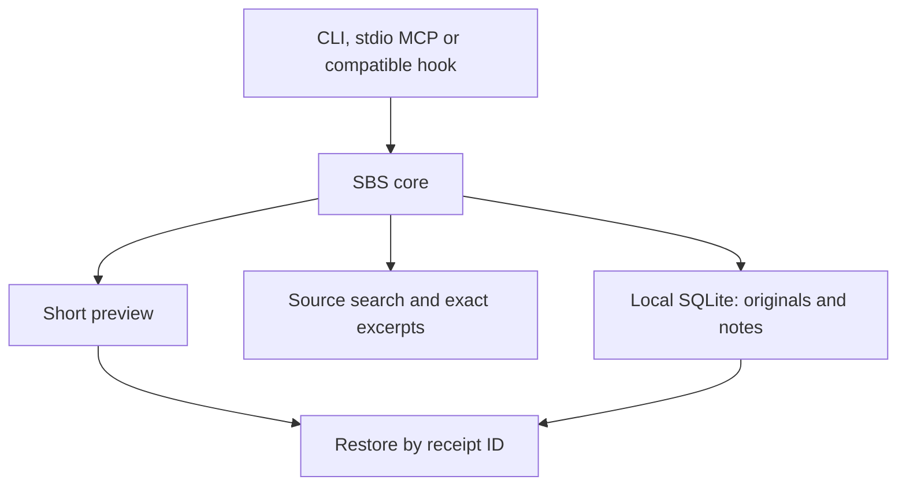

<div align="center">

# STOP-BULLSHITING

**Smaller terminal output. Inspectable previews. Recoverable originals.**

*A Python CLI for focused retrieval and smaller tool output. No mandatory runtime dependencies.*

[](https://github.com/searadacunha/Stop-Bullshiting/actions/workflows/ci.yml)


[Install](#install) · [Command guide](#command-guide) · [Integrations](#connect-to-claude-code-and-codex) · [Troubleshooting](#troubleshooting) · [Limits](#safety-privacy-and-limitations)

</div>

## Why it exists

Coding agents read huge logs, repetitive terminal output, massive JSON objects, code they never needed, and the same project notes again and again. That can waste context window space. **Stop-Bullshiting** replaces long outputs with bounded, inspectable previews, keeps originals available on disk, and makes focused retrieval easy.

```bash
sbs run -- git log --oneline -1000
sbs bench
```

Run the first command inside a Git repository. When output is reduced, copy the restoration command printed by SBS to read the full original again. `sbs bench` uses a built-in synthetic sample and needs no file.

**It does not increase Claude/Codex quotas, create extra tokens or guarantee lower bills.** It measures character reduction and optionally counts text with a named reference tokenizer; actual usage depends on the agent, model, caching and subsequent requests. Use the CLI directly to inspect its behavior before enabling automatic integrations.

## Features

| Feature | What it does |
|:--|:--|
| **Selective output reduction** | Shortens eligible JSON, logs and text; protects recognized diagnostics and leaves detected code, diffs and CSV unchanged in auto mode |
| **Targeted recovery** | Saves full originals locally; recover everything, exact line ranges or literal matches with context |
| **Agent hook adapters** | Opt-in Claude `PostToolUse` and Codex `PreToolUse` adapters; compatibility depends on the installed client |
| **Local MCP server** | Exposes search, AST symbols, exact lines, reversible compression and notes over stdio |
| **Symbol navigation** | Precise Python AST class/function locations, targeted excerpts |
| **Persistent notes** | Per-project local SQLite notes, never sent to an external indexing service |
| **Real usage counters** | Reads available local Claude/Codex session usage records without inventing tokens |
| **Benchmark mode** | Reports character counts, optional reference-token counts and a reproducible multi-fixture fidelity check |
| **Terminal identity** | ANSI banner when launching Claude Code or Codex |

## Install

**Python 3.10+** is required. The core runtime has no third-party Python dependencies. Reference-token counting is an optional extra, included by the macOS installer below. Installation does **not** activate new agent hooks; integrations are opt-in.

### macOS (recommended: installer without pipx)

Run this from **any directory**. It downloads the [installer](scripts/install_macos.sh) to a temporary file and runs it only if the download succeeds:

```bash
(
  set -e
  sbs_installer="$(mktemp "${TMPDIR:-/tmp}/sbs-install.XXXXXX")"
  trap 'rm -f "$sbs_installer"' EXIT
  curl -fsSL https://raw.githubusercontent.com/searadacunha/Stop-Bullshiting/main/scripts/install_macos.sh -o "$sbs_installer"
  bash "$sbs_installer"
)
```

The installer installs or repairs **version 0.2.0**, pinned to commit `b5d6681`, with the optional token counter in `~/.local/share/stop-bullshiting/venv`. No clone, Homebrew, `pipx` or `sudo` is needed. It adds the executable directory to your zsh `PATH`, backs up an existing shell configuration before changing it, and refreshes only SBS integrations you already enabled. It finishes by printing the version and running a benchmark with the built-in sample. Its first tokenizer use may download a public vocabulary table; benchmark text is not uploaded.

Then open a **new terminal** before using `sbs`, Claude Code or Codex. If an existing Codex hook was refreshed, review it with `/hooks` inside Codex. Check the installation with:

```bash
sbs --version
sbs bench --tokenizer o200k_base
```

To update an older installation to 0.2.0 or repair this installation, rerun the same installer commands and open a new terminal. This installer is pinned to 0.2.0; it does not promise a future latest version. `sbs` and `stop-bullshiting` are equivalent commands.

### macOS (alternative: pipx)

If you prefer `pipx` and have Homebrew, you can install directly from this GitHub repository. The `export` line makes the CLI available in the current terminal as well:

```bash
brew install pipx
pipx ensurepath
pipx install 'git+https://github.com/searadacunha/Stop-Bullshiting.git'
export PATH="$HOME/.local/bin:$PATH"
sbs doctor
sbs bench
```

If your terminal still reports `command not found: sbs`, open a new terminal and run `pipx list` to check whether the package was installed.

To update a pipx installation later:

```bash
pipx upgrade stop-bullshiting
```

### macOS / Linux (clone and virtual environment)

```bash
git clone https://github.com/searadacunha/Stop-Bullshiting.git
cd Stop-Bullshiting
python3 -m venv .venv
.venv/bin/python -m pip install -e .

.venv/bin/sbs doctor
.venv/bin/sbs bench
```

Run the editable installation command only from the cloned `Stop-Bullshiting` directory containing `pyproject.toml`. This method keeps the executable inside `.venv/bin/`. To run `sbs` without its path, activate the virtual environment with `source .venv/bin/activate` first.

To connect Claude Code or Codex, continue below only after the CLI is installed and `sbs doctor` succeeds.

## Command guide

| Need | Command | Result |
|:--|:--|:--|
| Reduce a command's output | `sbs run -- git log --oneline -1000` | Preview and local restoration ID when reduction is useful |
| Recover an original | Copy the `sbs show …` command printed in the preview | Complete stored text |
| Recover selected lines | Append `--start 120 --end 145` to that restoration command | Exact numbered lines from the original |
| Find inside an original | Append `--find "E_BALANCE" --context 3` to that restoration command | Literal matches and neighboring lines |
| Find Python definitions | `sbs map src --name compress` | AST function/class names and line ranges |
| Find a literal string | `sbs search "save_receipt" src` | Case-sensitive matching lines |
| Read exact lines | `sbs read src/stop_bullshiting/compress.py 1 30` | Numbered source excerpt |
| Compare reduction | `sbs bench` | Character counts for the built-in sample, without storing a receipt |
| Inspect recorded usage | `sbs usage all --json` | Available provider token counters, not attributed savings |

## Connect to Claude Code and Codex

Optional hook configuration is local, reversible and backed up:

```bash
sbs setup claude
sbs setup codex
```

Optional zsh launch functions make `claude` and `codex` show the logo:

```bash
sbs setup shell
```

Alternatively, enable all three at once:

```bash
sbs setup all
```

Open a **new terminal** after `sbs setup shell`. The launcher remembers the Python interpreter that installed it, so a virtual-environment installation does not require `sbs` on the new shell's `PATH`. Keep that environment in place; rerun setup if you move or reinstall it. Your original agent binaries still run.

**Compatibility:** hook schemas are version-dependent. This repository tests event handling and configuration round trips with local fixtures; that does not establish end-to-end support in every Claude Code or Codex release. `sbs doctor` reports executable paths and configuration presence, not active output replacement. Use `sbs run` explicitly if your client does not support the adapter. Installing the shell logo alone does not reduce agent output.

After `sbs setup codex`, open **`/hooks` inside Codex** to review and trust the new or changed hook; configuration alone does not activate it. See the [integration reference and upstream documentation](docs/INTEGRATIONS.md#documented-contracts).

To uninstall all integrations without uninstalling the package:

```bash
sbs setup all --remove
```

Existing hook configurations are merged, including preservation of third-party entries within a shared hook group; preexisting changed files are backed up. The shell launcher updates `.zshrc` when explicitly enabled; the macOS installer also uses it for the `PATH` entry. Authentication settings are not changed.

**Important:** Claude Code can rewrite a tool result after execution. Codex currently takes a different route: only narrowly allowlisted *read-only* commands are wrapped before execution. These are not interchangeable features. Both integrations deliberately fail open when an output cannot be handled safely.

## Real workflows

### Reduce terminal or pipeline output

Run these examples from a project checkout. Original exit status is preserved; stderr and failing-command output are not compacted.

```bash
sbs run -- git log --oneline -1000
sbs run -- rg "TODO" .
sbs run -- python3 -m unittest discover -s tests
```

Or explicitly pipe text (`run.log` must be an existing log file):

```bash
git log --oneline -1000 | sbs compress --mode plain --stats
cat run.log | sbs compress --mode logs --max-chars 2400
```

If a result is reduced, it includes a restoration command with a real receipt ID. This is an illustrative output format; `RECEIPT_ID` is not an ID to paste:

```text
... [193 lines omitted] ...
[SBS logs: 18602 → 2110 chars; full original: sbs show RECEIPT_ID]
```

Recover everything without loss by copying the complete `sbs show …` command from **your own SBS output**. To recover only what the next step needs, append `--find "request-0055" --context 3` to that command, or append `--start 120 --end 145` for a line range. Use a search string or line range that applies to your output.

Ranges are 1-based and inclusive. `--find` is case-sensitive and literal, and can be restricted with `--start` / `--end`. Selected views consider at most 50 source lines by default (`--limit` changes this) and fit within 20,000 characters including metadata. Matching lines take priority over context within the line limit. Omitted lines are reported explicitly; oversized lines are never silently shortened. Use `--context 0` for a tighter search response. `sbs show` followed by the real receipt ID, without selectors, still returns the complete original without a cap.

You can disable local storage using `sbs compress --no-store` or `sbs run --no-store -- command`.

### Protect evidence before reducing it

In `auto` mode, output detected as source code, a diff or CSV passes through unchanged. Use `sbs map`, `sbs search` and `sbs read` to retrieve less source code in the first place. The explicit `--mode code`, `--mode diff` and `--mode csv` options remain available for deliberately lossy previews.

Python traceback blocks pass through unchanged in auto, logs and plain modes. Recognized diagnostic lines in logs/text are kept whole or the original is returned. In JSON, recognized failing records, their parent branches and exact diagnostic values survive sampling, including records in the middle of arrays. If the protected view cannot fit the budget, SBS returns the original. These checks recognize common markers; they cannot identify every business-critical fact.

### Search code without dumping whole files

From the root of a Stop-Bullshiting clone:

```bash
sbs map src --name compress
sbs search "save_receipt" src
sbs read src/stop_bullshiting/compress.py 1 30
```

Python symbols use the syntax tree and report start/end line numbers. Search uses `rg` if available, with a Python fallback; both use case-sensitive literal matching. The fallback scans supported source/document extensions and skips large files and common build directories. Their file coverage can therefore differ.

### Keep compact project notes

```bash
sbs note put "test-command" "python3 -m unittest discover -s tests"
sbs note search "test"
sbs note get "test-command"
sbs note delete "test-command"
```

Notes are scoped to the current working directory unless `--scope` is specified. Avoid storing secrets.

### Analyze consumption

```bash
sbs stats
sbs usage claude
sbs usage codex
sbs usage all --json
sbs bench
```

**Different metrics, different meaning:** `sbs stats` and `sbs bench` measure characters, *not* actual model token cost. `sbs usage` reads token usage records, but cannot assign causality to this tool. A reliable savings claim needs an A/B test with equivalent tasks, model, caching and context.

### Optional reference-token measurement

The macOS installer already includes the token counter. Use the built-in sample from any directory:

```bash
sbs bench --tokenizer o200k_base
```

For a clone installation, run this **from the cloned directory containing `pyproject.toml`**, using the virtual environment created in the installation steps:

```bash
.venv/bin/python -m pip install -e '.[tokens]'
.venv/bin/sbs bench --tokenizer o200k_base
```

For a pipx installation, install the optional counter into its environment:

```bash
pipx inject stop-bullshiting 'tiktoken>=0.7,<1'
```

`o200k_base` and `cl100k_base` are named reference encodings, not a claim about the tokenizer of your current Claude or Codex model. The first explicit use may download a public vocabulary table; input text is not uploaded. Core compression, recovery and ordinary benchmarks remain offline and dependency-free.

`reference_token_counts` counts the actual preview, including its no-storage marker. `model_tokens_measured` remains `false`: the benchmark excludes wrapper diagnostics, tool envelopes, later recovery calls and provider billing. The built-in sample is highly repetitive and does not represent a whole coding session.

The multi-fixture benchmark also checks sentinel preservation, exact restoration, unchanged short output and local compression latency. Run it from the root of a clone:

```bash
python3 scripts/benchmark_compression.py
python3 scripts/benchmark_compression.py --tokenizer o200k_base
```

For a comparison, append `--baseline` followed by the actual path to an older source checkout. To inspect deliberately lossy modes separately:

```bash
python3 scripts/benchmark_compression.py --explicit-modes
```

This script never downloads a tokenizer: an unavailable dependency or uncached vocabulary produces `null` token counts with a reason. See [the comparison, measured results and next steps](docs/TOKEN_EFFICIENCY.md).

### MCP: 7 local tools

```bash
sbs mcp
```

MCP uses stdio JSON-RPC; no server port and no cloud embeddings. Register the command as an MCP server in a supported agent. For example, if the installed client supports the following `mcp add` interface:

```bash
claude mcp add stop-bullshiting -- sbs mcp
codex mcp add stop-bullshiting -- sbs mcp
```

If a client does not support that command format, use its MCP configuration UI and set command=`sbs`, args=`["mcp"]`. Registration differs by version and is not performed automatically by `setup`.

MCP tools: `sbs_compact`, `sbs_restore`, `sbs_symbols`, `sbs_search`, `sbs_read`, `sbs_note_save`, `sbs_note_find`.

`sbs_restore` accepts optional `start`, `end`, `query`, `context` and `limit` arguments. Agents can retrieve a diagnostic beyond the first 20,000 characters without resending the entire stored output.

## Architecture



See [docs/ARCHITECTURE.md](docs/ARCHITECTURE.md), [docs/INTEGRATIONS.md](docs/INTEGRATIONS.md) and [docs/SECURITY.md](docs/SECURITY.md).

## Troubleshooting

| Symptom | Check or action |
|:--|:--|
| `sbs: command not found` | After the macOS installer, open a new terminal; its executable is `~/.local/share/stop-bullshiting/venv/bin/sbs`. For pipx, check `pipx list` and run `pipx ensurepath`; for a clone, use `.venv/bin/sbs`. |
| `pipx: command not found` | Use the macOS installer above; it does not need pipx. Install pipx with Homebrew only if you choose the alternative method. |
| `unrecognized arguments: --tokenizer` | Check `sbs --version` and `command -v sbs`: an older installation may be selected. Rerun the macOS installer to install or repair 0.2.0, then open a new terminal. |
| `zsh: command not found: #` | Interactive zsh may treat pasted comments as commands. Copy only the command blocks; the explanations are outside them. |
| A shell parse error or an unknown receipt ID | Do not paste angle-bracket placeholders or illustrative IDs. Copy the complete restoration command printed by your own SBS output. |
| Editable installation reports that `.` is not installable | Run it from the root of the cloned repository containing `pyproject.toml`. The macOS installer works from any directory and needs no clone. |
| The logo appears but output stays large | The shell launcher only displays the banner. Try `sbs run` and check adapter compatibility before configuring hooks. |
| Small output stays unchanged | Expected: reduction occurs only when thresholds and the minimum useful gain are met. |
| A command reports `Reduction unavailable` | Its original stdout, stderr and exit status are preserved. Check available storage and `sbs doctor`; `--no-store` bypasses receipt storage. |
| A moved environment breaks a launch function | Reinstall the package and rerun `sbs setup shell`, or remove its marked block from `.zshrc`. |

## Safety, privacy and limitations

- Core operation needs no external HTTP requests, account credentials, proxy or model inference. Optional token counting may download a public vocabulary on first explicit use; it does not upload tool output or change subscription limits.
- Original outputs and notes are stored locally in SQLite, **compressed but not encrypted**. They can contain secrets if your commands emit them. Use `--no-store` for sensitive data and clean stored receipts with `sbs purge --older-than-days 30`.
- Truncation is **not semantically lossless**. The receipt guarantees access to the original, not identical model decisions. Recognized diagnostics are protected in auto/logs/plain/JSON handling; unrecognized facts and explicit lossy code/diff/CSV modes still require verification against the original.
- Invalid/corrupt configs are rejected rather than overwritten. Existing files are backed up; each installer can be reversed.
- `sbs run` captures stdout for bounded postprocessing. Use `sbs run --raw -- <command>` for interactive commands or anything needing streaming stdout.
- If receipt storage or reduction configuration fails after a command succeeds, `sbs run` emits the original output and keeps the command's exit status.
- Automatic hooks cover only clearly recognized command patterns. They are not a generalized proxy for every tool call or MCP message.
- The default local benchmark is synthetic and does not establish response-quality equivalence.

## Development

From the root of a cloned repository containing `pyproject.toml`, with the virtual environment created in the installation steps:

```bash
.venv/bin/python -m pip install -e .
.venv/bin/python -m unittest discover -s tests -v
.venv/bin/python -m stop_bullshiting doctor
```

Contributions welcome. See [CONTRIBUTING.md](CONTRIBUTING.md).

## License

MIT. See [LICENSE](LICENSE).


## Real coding-task benchmark status

The repository includes an offline **paired-session analysis tool** in `scripts/paired_sessions.py` and a [measurement protocol](docs/PAIRED_SESSIONS.md). It accepts recorded control/SBS task runs with provider tokens, costs, tool calls, restores, elapsed time, success and errors. **No paid agent-task comparisons have yet been run or claimed**; synthetic compression benchmarks are not evidence of end-to-end gains.
