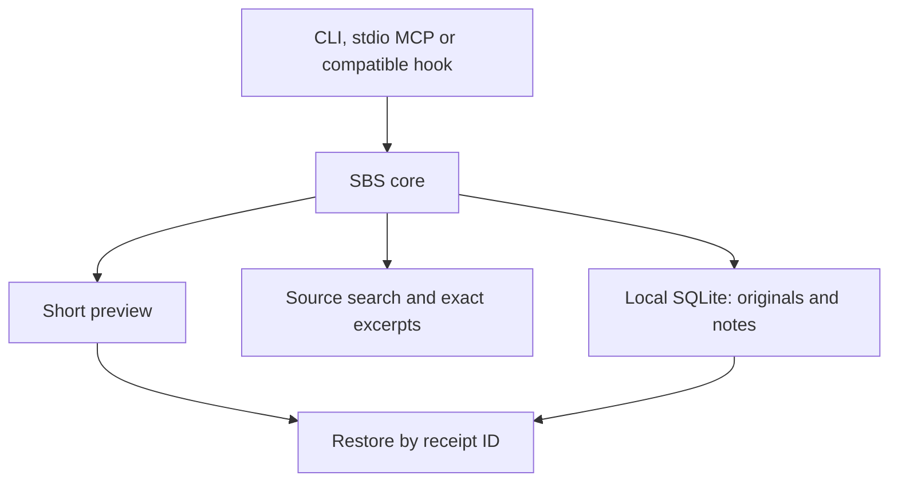

<div align="center">

# STOP-BULLSHITING

**Smaller terminal output. Inspectable previews. Recoverable originals.**

*A dependency-free Python CLI for reducing the context coding agents read.*

[](https://github.com/searadacunha/Stop-Bullshiting/actions/workflows/ci.yml)


[Install](#install) · [Command guide](#command-guide) · [Integrations](#connect-to-claude-code-and-codex) · [Troubleshooting](#troubleshooting) · [Limits](#safety-privacy-and-limitations)

</div>

## Why it exists

Coding agents read huge logs, repetitive terminal output, massive JSON objects, code they never needed, and the same project notes again and again. That can waste context window space. **Stop-Bullshiting** replaces long outputs with bounded, inspectable previews, keeps originals available on disk, and makes focused retrieval easy.

```bash
sbs run -- git log --oneline -1000      # Compact a command's successful stdout
sbs show <receipt-id>                  # Read its full original again
sbs bench                             # Measure a local synthetic example
```

**It does not increase Claude/Codex quotas, create extra tokens or guarantee lower bills.** It measures character reduction; actual usage depends on the agent, model, caching and subsequent requests. Use the CLI directly to inspect its behavior before enabling automatic integrations.

## Features

| Feature | What it does |
|:--|:--|
| **Output reduction** | Detects JSON, logs, diffs, code, CSV and generic text; keeps important errors and structural context |
| **Reversible receipts** | Saves full original locally, recoverable using `sbs show <id>` |
| **Agent hook adapters** | Opt-in Claude `PostToolUse` and Codex `PreToolUse` adapters; compatibility depends on the installed client |
| **Local MCP server** | Exposes search, AST symbols, exact lines, reversible compression and notes over stdio |
| **Symbol navigation** | Precise Python AST class/function locations, targeted excerpts |
| **Persistent notes** | Per-project local SQLite notes, never sent to an external indexing service |
| **Real usage counters** | Reads available local Claude/Codex session usage records without inventing tokens |
| **Benchmark mode** | Reports character reduction of synthetic examples or your real output samples |
| **Terminal identity** | ANSI banner when launching Claude Code or Codex |

## Install

**Python 3.10+** is required. The runtime has no third-party Python dependencies. Installation does **not** activate any agent hooks; integrations are opt-in.

### macOS (recommended: isolated CLI with pipx)

You can install directly from this GitHub repository, without a ZIP file or manual copy of the source:

```bash
brew install pipx
pipx ensurepath
pipx install 'git+https://github.com/searadacunha/Stop-Bullshiting.git'

# Make the CLI available in this terminal session as well:
export PATH="$HOME/.local/bin:$PATH"
sbs doctor
sbs bench
```

If your terminal still reports `command not found: sbs`, open a new terminal and run `pipx list` to check whether the package was installed. `sbs` and `stop-bullshiting` are equivalent commands.

### macOS / Linux (clone and virtual environment)

```bash
git clone https://github.com/searadacunha/Stop-Bullshiting.git
cd Stop-Bullshiting
python3 -m venv .venv
.venv/bin/python -m pip install -e .

.venv/bin/sbs doctor
.venv/bin/sbs bench
```

This second method keeps the executable inside `.venv/bin/`. To run `sbs` without its path, activate the virtual environment with `source .venv/bin/activate` first. Prefer `pipx` if you want the command available globally in your shell.

To connect Claude Code or Codex, continue below only after the CLI is installed and `sbs doctor` succeeds.

To update a pipx installation later:

```bash
pipx upgrade stop-bullshiting
```

## Command guide

| Need | Command | Result |
|:--|:--|:--|
| Reduce a command's output | `sbs run -- git log --oneline -1000` | Preview and local restoration ID when reduction is useful |
| Recover an original | `sbs show <receipt-id>` | Complete stored text |
| Find Python definitions | `sbs map src --name compress` | AST function/class names and line ranges |
| Find a literal string | `sbs search "save_receipt" src` | Case-sensitive matching lines |
| Read exact lines | `sbs read src/stop_bullshiting/compress.py 1 30` | Numbered source excerpt |
| Compare reduction | `sbs bench --file sample.log` | Character counts, without storing a receipt |
| Inspect recorded usage | `sbs usage all --json` | Available provider token counters, not attributed savings |

## Connect to Claude Code and Codex

```bash
# Optional hook configuration: local, reversible, with backups.
sbs setup claude
sbs setup codex

# Optional zsh launch functions: makes "claude" and "codex" show the logo.
sbs setup shell

# Or configure all three at once (explicit opt-in):
sbs setup all
```

Open a **new terminal** after `sbs setup shell`. The launcher remembers the Python interpreter that installed it, so a virtual-environment installation does not require `sbs` on the new shell's `PATH`. Keep that environment in place; rerun setup if you move or reinstall it. Your original agent binaries still run.

**Compatibility:** hook schemas are version-dependent. This repository tests event handling and configuration round trips with local fixtures; that does not establish end-to-end support in every Claude Code or Codex release. `sbs doctor` reports executable paths and configuration presence, not active output replacement. Use `sbs run` explicitly if your client does not support the adapter. Installing the shell logo alone does not reduce agent output.

After `sbs setup codex`, open **`/hooks` inside Codex** to review and trust the new or changed hook; configuration alone does not activate it. See the [integration reference and upstream documentation](docs/INTEGRATIONS.md#documented-contracts).

To uninstall all integrations without uninstalling the package:

```bash
sbs setup all --remove
```

Existing hook configurations are merged, including preservation of third-party entries within a shared hook group; preexisting changed files are backed up. `~/.zshrc` is used only if you explicitly enable the shell launcher. Authentication settings are not changed.

**Important:** Claude Code can rewrite a tool result after execution. Codex currently takes a different route: only narrowly allowlisted *read-only* commands are wrapped before execution. These are not interchangeable features. Both integrations deliberately fail open when an output cannot be handled safely.

## Real workflows

### Reduce terminal or pipeline output

```bash
# Original exit status is preserved; stderr and failing-command output are not compacted.
sbs run -- git log --oneline -1000
sbs run -- rg "TODO" .
sbs run -- python3 -m unittest discover -s tests

# Or explicitly pipe any text:
git log --oneline -1000 | sbs compress --mode plain --stats
cat run.log | sbs compress --mode logs --max-chars 2400
```

If a result is reduced, it includes an ID:

```text
... [193 lines omitted] ...
[SBS logs: 18602 → 2110 chars; full original: sbs show a1b2c3d4e5f601]
```

Recover everything without loss:

```bash
sbs show a1b2c3d4e5f601
```

You can disable local storage using `sbs compress --no-store` or `sbs run --no-store -- command`.

### Search code without dumping whole files

```bash
sbs map . --name validate_transaction
sbs search "create_signature" .
sbs read src/my_module.py 88 135
```

Python symbols use the syntax tree and report start/end line numbers. Search uses `rg` if available, with a Python fallback; both use case-sensitive literal matching. The fallback scans supported source/document extensions and skips large files and common build directories. Their file coverage can therefore differ.

### Keep compact project notes

```bash
sbs note put "test-command" "python3 -m unittest discover -s tests"
sbs note search "test"
sbs note get "test-command"
sbs note delete "test-command"
```

Notes are scoped to the current working directory unless `--scope` is specified. Avoid storing secrets.

### Analyze consumption

```bash
sbs stats             # Observed reduction in characters in SBS receipts
sbs usage claude      # Real counters if locally recorded by Claude Code
sbs usage codex       # Real counters if locally recorded by Codex
sbs usage all --json
sbs bench --file sample.log --mode logs
```

**Different metrics, different meaning:** `sbs stats` and `sbs bench` measure characters, *not* actual model token cost. `sbs usage` reads token usage records, but cannot assign causality to this tool. A reliable savings claim needs an A/B test with equivalent tasks, model, caching and context.

### MCP: 7 local tools

```bash
sbs mcp
```

MCP uses stdio JSON-RPC; no server port and no cloud embeddings. Register the command as an MCP server in a supported agent. For example, if the installed client supports the following `mcp add` interface:

```bash
claude mcp add stop-bullshiting -- sbs mcp
codex mcp add stop-bullshiting -- sbs mcp
```

If a client does not support that command format, use its MCP configuration UI and set command=`sbs`, args=`["mcp"]`. Registration differs by version and is not performed automatically by `setup`.

MCP tools: `sbs_compact`, `sbs_restore`, `sbs_symbols`, `sbs_search`, `sbs_read`, `sbs_note_save`, `sbs_note_find`.

## Architecture



See [docs/ARCHITECTURE.md](docs/ARCHITECTURE.md), [docs/INTEGRATIONS.md](docs/INTEGRATIONS.md) and [docs/SECURITY.md](docs/SECURITY.md).

## Troubleshooting

| Symptom | Check or action |
|:--|:--|
| `sbs: command not found` | Confirm installation with `pipx list`, then open a new terminal after `pipx ensurepath`; for a clone, use `.venv/bin/sbs`. |
| The logo appears but output stays large | The shell launcher only displays the banner. Try `sbs run` and check adapter compatibility before configuring hooks. |
| Small output stays unchanged | Expected: reduction occurs only when thresholds and the minimum useful gain are met. |
| A command reports `Reduction unavailable` | Its original stdout, stderr and exit status are preserved. Check available storage and `sbs doctor`; `--no-store` bypasses receipt storage. |
| A moved environment breaks a launch function | Reinstall the package and rerun `sbs setup shell`, or remove its marked block from `.zshrc`. |

## Safety, privacy and limitations

- No external HTTP requests, account credentials, proxy, model inference or subscription-limit changes.
- Original outputs and notes are stored locally in SQLite, **compressed but not encrypted**. They can contain secrets if your commands emit them. Use `--no-store` for sensitive data and clean stored receipts with `sbs purge --older-than-days 30`.
- Truncation is **not semantically lossless**. The receipt guarantees access to the original, not identical model decisions. Errors are prioritized but can still be omitted under very small budgets.
- Invalid/corrupt configs are rejected rather than overwritten. Existing files are backed up; each installer can be reversed.
- `sbs run` captures stdout for bounded postprocessing. Use `sbs run --raw -- <command>` for interactive commands or anything needing streaming stdout.
- If receipt storage or reduction configuration fails after a command succeeds, `sbs run` emits the original output and keeps the command's exit status.
- Automatic hooks cover only clearly recognized command patterns. They are not a generalized proxy for every tool call or MCP message.
- The default local benchmark is synthetic and does not establish response-quality equivalence.

## Development

```bash
python3 -m pip install -e .
python3 -m unittest discover -s tests -v
python3 -m stop_bullshiting doctor
```

Contributions welcome. See [CONTRIBUTING.md](CONTRIBUTING.md).

## License

MIT. See [LICENSE](LICENSE).
